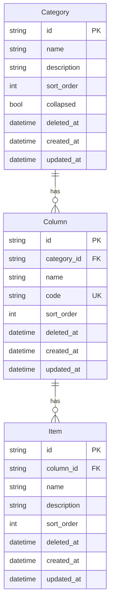
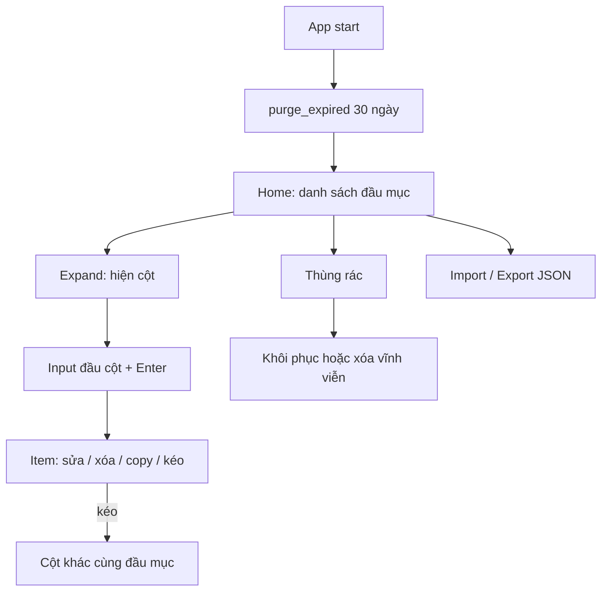

# Kế hoạch triển khai: Offline Task Board (Windows)

Tài liệu này là đặc tả đầy đủ để triển khai ứng dụng. Gồm yêu cầu gốc, quyết định đã chốt, mô hình dữ liệu, UX, API, và thứ tự làm việc.

---

## 1. Tóm tắt sản phẩm

Ứng dụng **desktop native, chạy offline** trên **Windows 10 / Windows 11**, quản lý các **đầu mục nhiệm vụ** dạng board cột động (giống kanban nhẹ). Người dùng tạo đầu mục, thêm cột, thêm item vào cột, kéo-thả sắp xếp / chuyển cột, đưa mọi thao tác xóa vào **thùng rác** (khôi phục được), và **import/export database dạng JSON**.

**Mục tiêu phi chức năng:** ít RAM, thao tác mượt, không cần mạng sau khi cài.

---

## 2. Yêu cầu gốc (chi tiết)

### 2.1. Môi trường & mục tiêu

| Hạng mục     | Yêu cầu                                     |
| ------------ | ------------------------------------------- |
| Hệ điều hành | Windows 10, Windows 11                      |
| Chế độ chạy  | Offline (không phụ thuộc server / internet) |
| Hiệu năng    | Sử dụng ít RAM, UI mượt mà                  |
| Sao lưu      | Import / export toàn bộ database dạng JSON  |

### 2.2. Thùng rác (soft delete)

- **Mọi thao tác xóa** không xóa cứng ngay.
- Bản ghi bị xóa được đẩy vào **thùng rác**.
- Xóa thật sự chỉ khi:
  1. Đã quá **30 ngày** kể từ lúc đưa vào thùng rác, hoặc
  2. Người dùng **chủ động xóa vĩnh viễn / dọn dẹp** trong mục thùng rác.
- Phải có **màn / mục Thùng rác** để xem, khôi phục, và dọn dẹp.

### 2.3. Đầu mục nhiệm vụ (Category)

- Người dùng **thêm / xóa / sửa** các đầu mục nhiệm vụ.
- Ví dụ tên đầu mục: `Triển khai văn bản bị thu hồi`.
- Khi tạo mới bắt buộc nhập:
  - `name` — **bắt buộc**
  - `description` — tùy chọn

### 2.4. Cột trong đầu mục (Column)

- Mỗi đầu mục có các cột quản lý động (ví dụ: `Đang chạy`, `Chờ chạy`).
- Số lượng cột **không cố định** — có thể **thêm / xóa** cột.
- Khi thêm cột bắt buộc nhập:
  - `name` — **bắt buộc**
  - `code` — **bắt buộc**, **unique**, dùng làm định danh nghiệp vụ của cột (id logic)

### 2.5. Màn Home

- Hiển thị **danh sách các đầu mục nhiệm vụ**.
- Có thể **kéo di chuyển** để sắp xếp thứ tự đầu mục.
- Click vào đầu mục để **collapse / expand**:
  - Expand: hiện các cột thuộc đầu mục
  - Collapse: ẩn các cột

### 2.6. Item trong cột

- Trong mỗi cột có thể:
  - Tạo mới item
  - Sửa item
  - Xóa item (vào thùng rác)
  - **Kéo thả item sang cột khác** (cùng đầu mục)
- Mỗi item có:
  - `name` — **bắt buộc**
  - `description` — tùy chọn
- **Đầu mỗi cột** có ô input để nhập `name` item; nhấn **Enter** → tạo mới item.
- Mỗi item có **2 nút**:
  - **Xóa** — soft delete vào thùng rác
  - **Copy** — copy `name` vào clipboard hệ thống

---

## 3. Quyết định đã chốt (làm rõ yêu cầu)

| #   | Câu hỏi                          | Quyết định                                                                                    |
| --- | -------------------------------- | --------------------------------------------------------------------------------------------- |
| 1   | Hình thức phân phối              | **Desktop native** (installer `.exe` / `.msi`), không phải web-only                           |
| 2   | Phạm vi thùng rác                | **Mọi thứ bị xóa** đều vào thùng rác: đầu mục, cột, item — **có thể khôi phục**               |
| 3   | Stack                            | **Tauri 2 + React + TypeScript + SQLite** (xem mục 4)                                         |
| 4   | Import MVP                       | **Thay thế toàn bộ** sau khi confirm (không merge nửa vời ở slice đầu)                        |
| 5   | Export mặc định                  | Export **toàn bộ** (active + trash) để backup trung thực; có tùy chọn “chỉ dữ liệu đang dùng” |
| 6   | Cột mặc định khi tạo đầu mục mới | Tạo sẵn 2 cột: `Đang chạy` / `running`, `Chờ chạy` / `pending`                                |
| 7   | Restore khi thiếu cha            | **Khôi phục kèm chuỗi cha bị thiếu** + toast giải thích                                       |
| 8   | Sắp xếp cột                      | Có lưu `sort_order` và **kéo sắp xếp cột** trong đầu mục                                      |

### 3.1. Ngoài phạm vi slice đầu (không làm)

- Đồng bộ đa máy / tài khoản / cloud
- File đính kèm, tags, due date, assignee
- Search full-text nâng cao
- Multi-window, plugin, theme marketplace
- Undo/redo stack phức tạp ngoài khôi phục từ thùng rác
- Mobile / macOS / Linux như target chính (dev trên Linux được, ship Windows)

---

## 4. Lựa chọn công nghệ & lý do

### 4.1. Vì sao Tauri 2 + React (không pure Rust / Electron / .NET)

Ứng dụng có UI tương tác nặng: kéo-thả đầu mục & item giữa cột, collapse/expand, quick-add, clipboard. Cần cân giữa **ít RAM** và **tốc độ làm UX board**.

| Lựa chọn                              | Ưu                                                                                                                                                             | Nhược với bài toán này                                                      |
| ------------------------------------- | -------------------------------------------------------------------------------------------------------------------------------------------------------------- | --------------------------------------------------------------------------- |
| **Tauri 2 + React (chọn)**            | UI board/DnD làm nhanh bằng web tech; backend Rust mỏng (FS, DB, clipboard); Windows dùng **WebView2 có sẵn** → RAM thấp hơn Electron rõ rệt; đóng gói offline | Không phải native widget 100%                                               |
| Pure Rust (`egui` / `iced` / `Slint`) | RAM thấp, native                                                                                                                                               | DnD board nhiều cột + polish UX tốn công hơn nhiều; ít thư viện kanban chín |
| Electron + React                      | Ecosystem quen                                                                                                                                                 | **Tốn RAM** — trái yêu cầu                                                  |
| WinUI / WPF (.NET)                    | Native Windows tốt                                                                                                                                             | Cross-build từ môi trường Linux khó hơn; DnD board vẫn phải tự làm          |

**Kết luận:** UI ở React để ship đúng trải nghiệm board; phần hệ thống/offline/DB ở Rust qua Tauri để nhẹ và an toàn.

### 4.2. Stack cụ thể

| Tầng              | Công nghệ                                          |
| ----------------- | -------------------------------------------------- |
| Shell desktop     | Tauri 2 (Windows 10/11, WebView2)                  |
| UI                | React + TypeScript + Vite                          |
| Style / primitive | Tailwind CSS + shadcn/ui                           |
| Kéo-thả           | `@dnd-kit`                                         |
| Lưu trữ           | SQLite (file trong `app_data_dir`)                 |
| I/O JSON          | Validate schema phía Rust hoặc TS trước khi ghi DB |
| Đóng gói          | Tauri bundler → NSIS (`.exe`) và/hoặc MSI          |

**Không dùng:** auth, server, database remote, Electron.

---

## 5. Mô hình dữ liệu

### 5.1. Quan hệ



### 5.2. Quy ước field

| Entity   | Field         | Bắt buộc | Ghi chú                                                                   |
| -------- | ------------- | -------- | ------------------------------------------------------------------------- |
| Category | `id`          | Có       | UUID                                                                      |
| Category | `name`        | Có       | Trim; không rỗng                                                          |
| Category | `description` | Không    | Mặc định `""`                                                             |
| Category | `sort_order`  | Có       | Thứ tự trên Home                                                          |
| Category | `collapsed`   | Có       | `true` = đang thu gọn                                                     |
| Category | `deleted_at`  | Không    | `NULL` = đang dùng                                                        |
| Column   | `id`          | Có       | UUID (id kỹ thuật)                                                        |
| Column   | `category_id` | Có       | FK đầu mục                                                                |
| Column   | `name`        | Có       | Hiển thị                                                                  |
| Column   | `code`        | Có       | Unique toàn DB (kể cả bản ghi trash chưa purge); charset `[a-zA-Z0-9_-]+` |
| Column   | `sort_order`  | Có       | Thứ tự cột trong đầu mục                                                  |
| Column   | `deleted_at`  | Không    | Soft delete                                                               |
| Item     | `id`          | Có       | UUID                                                                      |
| Item     | `column_id`   | Có       | FK cột                                                                    |
| Item     | `name`        | Có       | Trim; không rỗng                                                          |
| Item     | `description` | Không    | Mặc định `""`                                                             |
| Item     | `sort_order`  | Có       | Thứ tự trong cột                                                          |
| Item     | `deleted_at`  | Không    | Soft delete                                                               |

### 5.3. Soft delete & cascade

**Xóa (soft):**

1. Xóa **item** → set `deleted_at = now` cho item.
2. Xóa **cột** → soft-delete cột + mọi item thuộc cột (active).
3. Xóa **đầu mục** → soft-delete đầu mục + mọi cột + mọi item thuộc đầu mục (active).

**Khôi phục:**

1. Restore **đầu mục** → `deleted_at = NULL`. Children vẫn trong trash trừ khi chọn “Khôi phục kèm nội dung”.
2. Restore **cột** → nếu đầu mục cha đang trash → **auto-restore cha** + toast. Có nút/option “kèm items đã xóa cùng đợt” (MVP: nút **Khôi phục kèm nội dung** restore mọi child đang trash của entity đó).
3. Restore **item** → nếu cột/đầu mục cha đang trash → **auto-restore chuỗi cha** + toast.

**Xóa vĩnh viễn / purge:**

- Thủ công từng bản ghi hoặc “Dọn tất cả” / “Dọn quá 30 ngày” trong Thùng rác.
- **Tự động khi mở app:** hard-delete mọi bản ghi có `deleted_at <= now - 30 days` (thứ tự: item → column → category để tránh FK orphan, hoặc `ON DELETE` tương đương bằng transaction).

### 5.4. Unique `code`

- So sánh sau `trim`.
- Không cho trùng với bất kỳ cột nào còn tồn tại trong DB (active **và** trash chưa purge).
- Khi restore cột, nếu `code` bị trùng với cột active khác → báo lỗi, không restore (trường hợp hiếm nếu unique toàn DB được enforce từ đầu).

---

## 6. Đặc tả chức năng chi tiết

### 6.1. Home — danh sách đầu mục

**Hiển thị**

- Danh sách đầu mục `deleted_at IS NULL`, sort theo `sort_order ASC`.
- Mỗi hàng/khối đầu mục: tên, mô tả ngắn (1 dòng, truncate), nút sửa, nút xóa, handle kéo.
- Click header đầu mục → toggle `collapsed`; persist ngay xuống DB.

**Sắp xếp**

- Kéo-thả đổi thứ tự đầu mục → cập nhật `sort_order` toàn bộ danh sách (hoặc cặp affected) trong transaction.

**Empty state**

- Chưa có đầu mục: message + CTA “Tạo đầu mục đầu tiên”.

**Tạo / sửa đầu mục**

- Dialog:
  - `name` (required)
  - `description` (optional textarea)
- Tạo mới thành công → insert category + **2 cột mặc định** (`Đang chạy`/`running`, `Chờ chạy`/`pending`) với `sort_order` 0 và 1; mở expand category mới.

**Xóa đầu mục**

- Confirm ngắn (“Chuyển vào thùng rác cùng toàn bộ cột và item?”) → cascade soft-delete.

### 6.2. Cột trong đầu mục (khi expand)

**Hiển thị**

- Các cột active của đầu mục, ngang (horizontal scroll nếu thiếu chỗ), theo `sort_order`.
- Header cột: tên + code (phụ, nhỏ) + menu (sửa / xóa) + handle kéo sắp xếp cột.

**Thêm cột**

- Dialog: `name` (required), `code` (required, validate unique + charset).
- Insert cuối danh sách cột (`max(sort_order)+1`).

**Sửa cột**

- Dialog tương tự; đổi `code` phải pass unique.

**Xóa cột**

- Confirm → soft-delete cột + items.

**Quick-add item**

- Ô input ở **đầu cột**, placeholder kiểu “Thêm item…”.
- Enter với name không rỗng → tạo item (`description = ""`, `sort_order = max+1` hoặc `0` đẩy lên đầu — **chọn: thêm vào cuối cột**).
- Clear input sau khi tạo; giữ focus để nhập tiếp.
- Name rỗng + Enter → không tạo, có thể shake/hint nhẹ.

### 6.3. Item

**Hiển thị**

- Card/row: `name` (chính), `description` (phụ, 1–2 dòng truncate nếu có).
- Hai nút luôn thấy hoặc hiện khi hover (mobile/desktop: ưu tiên luôn thấy trên Windows desktop):
  - **Copy** → ghi `name` vào clipboard; toast “Đã copy”.
  - **Xóa** → soft-delete (confirm nhẹ hoặc xóa thẳng vào trash — **chọn: xóa thẳng vào trash, không confirm** để thao tác nhanh; có thể Ctrl+Z không có → dựa vào thùng rác).

**Sửa**

- Nút sửa hoặc double-click → dialog `name` + `description`.

**Kéo thả**

- Trong cùng cột: đổi `sort_order`.
- Sang cột khác **cùng đầu mục**: đổi `column_id` + `sort_order` tại vị trí thả.
- Không cho kéo item sang đầu mục khác trong MVP (tránh UX phức tạp).

### 6.4. Thùng rác

**Nav**

- Entry rõ trên shell: “Thùng rác” (kèm badge số lượng nếu tiện).

**List**

- Tab/filter: Tất cả | Đầu mục | Cột | Item.
- Mỗi dòng: loại, tên, mô tả/code phụ, thời điểm xóa, số ngày còn lại trước auto-purge (tính từ `deleted_at + 30 ngày`).
- Action từng dòng: **Khôi phục**, **Khôi phục kèm nội dung** (với category/column), **Xóa vĩnh viễn**.

**Bulk**

- Dọn các mục quá 30 ngày.
- Dọn tất cả (confirm mạnh).

**Empty state**

- “Thùng rác trống”.

### 6.5. Import / Export JSON

**Export**

- Nút Export → save file dialog (Tauri dialog plugin).
- Nội dung versioned (xem mục 7).
- Tùy chọn checkbox: “Bao gồm thùng rác” (default **bật**).

**Import**

- Chọn file JSON → validate schema + version.
- Confirm: “Thay thế toàn bộ dữ liệu hiện tại? Thao tác không hoàn tác trừ khi bạn còn file backup.”
- Trong transaction: xóa toàn bộ bảng → insert từ JSON.
- Lỗi schema / version không hỗ trợ → không đụng DB, hiện lỗi rõ.

### 6.6. Trạng thái & lỗi cần cover

| Trạng thái                 | Hành vi                                   |
| -------------------------- | ----------------------------------------- |
| Home trống                 | CTA tạo đầu mục                           |
| Đầu mục expand nhưng 0 cột | CTA thêm cột                              |
| Cột 0 item                 | Chỉ hiện quick-add                        |
| Trash trống                | Empty copy                                |
| Trùng `code`               | Inline error trên form, không đóng dialog |
| Import JSON sai            | Toast/dialog lỗi, DB giữ nguyên           |
| Copy clipboard fail        | Toast lỗi                                 |
| DB file lỗi/corrupt        | Màn lỗi + gợi ý restore từ JSON backup    |

### 6.7. Phím tắt (tối thiểu)

| Phím  | Hành vi                                                   |
| ----- | --------------------------------------------------------- |
| Enter | Trong quick-add → tạo item; trong dialog primary → submit |
| Esc   | Đóng dialog                                               |

---

## 7. Schema JSON import/export

### 7.1. Format

```json
{
  "version": 1,
  "exportedAt": "2026-11-05T04:00:00.000Z",
  "categories": [
    {
      "id": "uuid",
      "name": "Triển khai văn bản bị thu hồi",
      "description": "",
      "sortOrder": 0,
      "collapsed": false,
      "deletedAt": null,
      "createdAt": "2026-11-05T04:00:00.000Z",
      "updatedAt": "2026-11-05T04:00:00.000Z",
      "columns": [
        {
          "id": "uuid",
          "name": "Đang chạy",
          "code": "running",
          "sortOrder": 0,
          "deletedAt": null,
          "createdAt": "2026-11-05T04:00:00.000Z",
          "updatedAt": "2026-11-05T04:00:00.000Z",
          "items": [
            {
              "id": "uuid",
              "name": "Soạn tờ trình",
              "description": "",
              "sortOrder": 0,
              "deletedAt": null,
              "createdAt": "2026-11-05T04:00:00.000Z",
              "updatedAt": "2026-11-05T04:00:00.000Z"
            }
          ]
        }
      ]
    }
  ]
}
```

### 7.2. Rule validate khi import

- `version` phải `=== 1` (slice đầu chỉ hỗ trợ v1).
- `categories` là array.
- Mỗi category/column/item đủ field bắt buộc.
- Mọi `code` trong file pairwise unique.
- `deletedAt` nhận `null` hoặc ISO-8601 string.
- Reject nếu phát hiện ID trùng trong cùng loại entity.

---

## 8. Kiến trúc ứng dụng

### 8.1. Cấu trúc thư mục

```text
/
├── src-tauri/
│   ├── src/
│   │   ├── main.rs
│   │   ├── lib.rs
│   │   ├── db.rs              # mở SQLite, migrate, path app_data
│   │   ├── commands/
│   │   │   ├── category.rs
│   │   │   ├── column.rs
│   │   │   ├── item.rs
│   │   │   ├── trash.rs
│   │   │   ├── reorder.rs
│   │   │   └── io.rs          # import/export
│   │   └── error.rs
│   ├── migrations/            # SQL schema
│   ├── Cargo.toml
│   └── tauri.conf.json
├── src/
│   ├── main.tsx
│   ├── App.tsx                # shell nav: Home | Trash | Data
│   ├── pages/
│   │   ├── HomePage.tsx
│   │   ├── TrashPage.tsx
│   │   └── DataPage.tsx       # import/export
│   ├── components/
│   │   ├── CategoryList.tsx
│   │   ├── CategoryBlock.tsx
│   │   ├── ColumnBoard.tsx
│   │   ├── ColumnView.tsx
│   │   ├── ItemCard.tsx
│   │   ├── QuickAddInput.tsx
│   │   ├── trash/
│   │   └── dialogs/
│   │       ├── CategoryFormDialog.tsx
│   │       ├── ColumnFormDialog.tsx
│   │       └── ItemFormDialog.tsx
│   ├── lib/
│   │   ├── types.ts
│   │   ├── api.ts             # invoke wrappers
│   │   ├── json-schema.ts
│   │   └── utils.ts
│   └── styles/
├── docs/
│   └── KE-HOACH-TRIEN-KHAI.md
├── package.json
├── vite.config.ts
└── README.md
```

### 8.2. Tauri commands tối thiểu

| Command                                                  | Mô tả                                                            |
| -------------------------------------------------------- | ---------------------------------------------------------------- |
| `list_categories`                                        | Categories active + columns/items active (hoặc lazy theo expand) |
| `create_category`                                        | Tạo + 2 cột mặc định                                             |
| `update_category`                                        | Đổi name/description/collapsed                                   |
| `soft_delete_category`                                   | Cascade soft-delete                                              |
| `reorder_categories`                                     | Cập nhật sort_order[]                                            |
| `create_column` / `update_column` / `soft_delete_column` | CRUD cột                                                         |
| `reorder_columns`                                        | Trong 1 category                                                 |
| `create_item` / `update_item` / `soft_delete_item`       | CRUD item                                                        |
| `move_item`                                              | Đổi column_id + sort_order (DnD)                                 |
| `reorder_items`                                          | Trong 1 cột                                                      |
| `list_trash`                                             | Mọi entity `deleted_at IS NOT NULL`                              |
| `restore_entity`                                         | `{ type, id, withChildren: bool }` + auto-restore parents        |
| `purge_entity`                                           | Hard delete 1 bản ghi (+ children nếu cần)                       |
| `purge_expired`                                          | Hard delete > 30 ngày                                            |
| `purge_all_trash`                                        | Hard delete toàn trash                                           |
| `export_json`                                            | `{ includeTrash: bool }` → string/path                           |
| `import_json`                                            | Replace-all từ string                                            |
| `copy_text`                                              | Clipboard (hoặc dùng API web clipboard trong WebView)            |
| `run_startup_maintenance`                                | Gọi `purge_expired` lúc boot                                     |

### 8.3. Luồng UI



---

## 9. Hiệu năng / ít RAM

1. Dùng Tauri (WebView2) — không nhúng Chromium.
2. Một cửa sổ chính.
3. SQLite single-file tại thư mục data của app.
4. Load Home: có thể load categories trước; columns/items theo category đang expand **hoặc** một query gọn có filter `deleted_at IS NULL` nếu data vừa phải.
5. DnD: optimistic UI + ghi DB; không remount cả app.
6. Virtualize danh sách item **chỉ khi** một cột > ~100 item (không làm sớm nếu chưa cần).
7. Purge 30 ngày giúp DB không phình vô hạn.

---

## 10. UX / UI notes (Windows desktop)

- Layout shell: top hoặc side nav gọn — **Home**, **Thùng rác**, **Dữ liệu** (import/export).
- Ưu tiên mật độ thông tin vừa phải, không dashboard thống kê.
- Dialog form thống nhất (shadcn Dialog + Input + Textarea + Button).
- Confirm chỉ cho hành động phá hủy mạnh: xóa đầu mục/cột, import replace, purge all.
- Toast cho copy / restore / lỗi nhẹ.
- Hỗ trợ resize cửa sổ; cột horizontal scroll; Home vertical scroll.
- Không phụ thuộc mạng cho bất kỳ thao tác nào ở trên.

---

## 11. Đóng gói & chạy trên Windows

### 11.1. Dev

```bash
npm install
npm run tauri dev
```

### 11.2. Build installer

```bash
npm run tauri build
```

Artifact: NSIS/MSI trong `src-tauri/target/release/bundle/`.

### 11.3. Phụ thuộc hệ thống

- **WebView2 Runtime** (Windows 11 thường có sẵn; Windows 10 cần kiểm tra / bootstrapper).
- Ghi rõ trong README: vị trí file DB (ví dụ `%APPDATA%\<app>\data.db`), cách backup bằng Export JSON.

---

## 12. Thứ tự triển khai (phases)

### Phase 0 — Tài liệu & scaffold

- [x] Xuất kế hoạch chi tiết (`docs/KE-HOACH-TRIEN-KHAI.md`)
- [x] Scaffold Tauri 2 + Vite React TS + Tailwind + shadcn
- [x] README: chạy dev, build Windows, WebView2, vị trí DB

### Phase 1 — Database & commands

- [x] Migration SQLite (categories, columns, items + index `deleted_at`, unique `columns.code`)
- [x] Commands CRUD + reorder + soft-delete cascade + restore + purge
- [x] `run_startup_maintenance` khi boot

### Phase 2 — Home board UI

- [x] Category list + DnD reorder + collapse/expand persist
- [x] Column board + quick-add Enter
- [x] Item card: edit dialog, delete → trash, copy clipboard
- [x] DnD item trong cột / sang cột khác
- [x] DnD reorder cột
- [x] Dialog tạo/sửa category & column + validate `code`

### Phase 3 — Thùng rác

- [x] Trash page + filter loại
- [x] Restore / restore kèm nội dung / purge one / purge expired / purge all
- [x] Hiển thị ngày còn lại trước auto-purge

### Phase 4 — Import / Export & polish

- [x] Export/import JSON v1 + validate
- [x] Empty / loading / error states
- [ ] Smoke test thủ công checklist mục 13
- [ ] Commit / push; ghi chú build installer trên máy Windows

---

## 13. Checklist nghiệm thu

### Chức năng

- [ ] Tạo / sửa / xóa (trash) đầu mục với name required + description
- [ ] Tạo đầu mục mới có sẵn 2 cột `Đang chạy`/`running`, `Chờ chạy`/`pending`
- [ ] Thêm / sửa / xóa cột; `code` unique bắt buộc
- [ ] Home kéo sắp xếp đầu mục; thứ tự giữ sau restart
- [ ] Collapse / expand đầu mục; trạng thái giữ sau restart
- [ ] Quick-add Enter tạo item chỉ với name
- [ ] Sửa item (name + description)
- [ ] Xóa item vào trash; Copy name vào clipboard
- [ ] Kéo item đổi thứ tự / sang cột khác; giữ sau restart
- [ ] Kéo sắp xếp cột
- [ ] Trash: xem, restore (kèm cha nếu cần), xóa vĩnh viễn, dọn 30 ngày, dọn tất cả
- [ ] Mở app sau >30 ngày (giả lập `deleted_at`) → auto purge
- [ ] Export JSON; import replace-all; import file hỏng không phá DB
- [ ] App hoạt động tắt mạng

### Phi chức năng

- [ ] Không dùng Electron
- [ ] Một process cửa sổ chính ổn định
- [ ] README đủ để người khác build/run trên Windows 10/11

---

## 14. Rủi ro & giảm thiểu

| Rủi ro                    | Giảm thiểu                                                                       |
| ------------------------- | -------------------------------------------------------------------------------- |
| WebView2 thiếu trên Win10 | README + link bootstrapper; Tauri bundle có thể kèm số                           |
| Build Windows từ CI Linux | Dev UI trên Linux; hướng dẫn build installer trên máy Windows thật               |
| Mất dữ liệu khi import    | Confirm rõ; khuyến khích export backup trước                                     |
| Trùng code khi restore    | Unique toàn DB kể cả trash                                                       |
| DnD buggy                 | Dùng `@dnd-kit`; test cross-column kỹ; optimistic + rollback toast nếu lệnh fail |

---

## 15. Định nghĩa “xong” slice đầu

Ứng dụng desktop offline trên Windows cho phép quản lý đầu mục → cột động → item với kéo-thả, mọi xóa đi vào thùng rác có khôi phục và tự xóa sau 30 ngày / dọn thủ công, và sao lưu/phục hồi qua JSON — đủ checklist mục 13.
